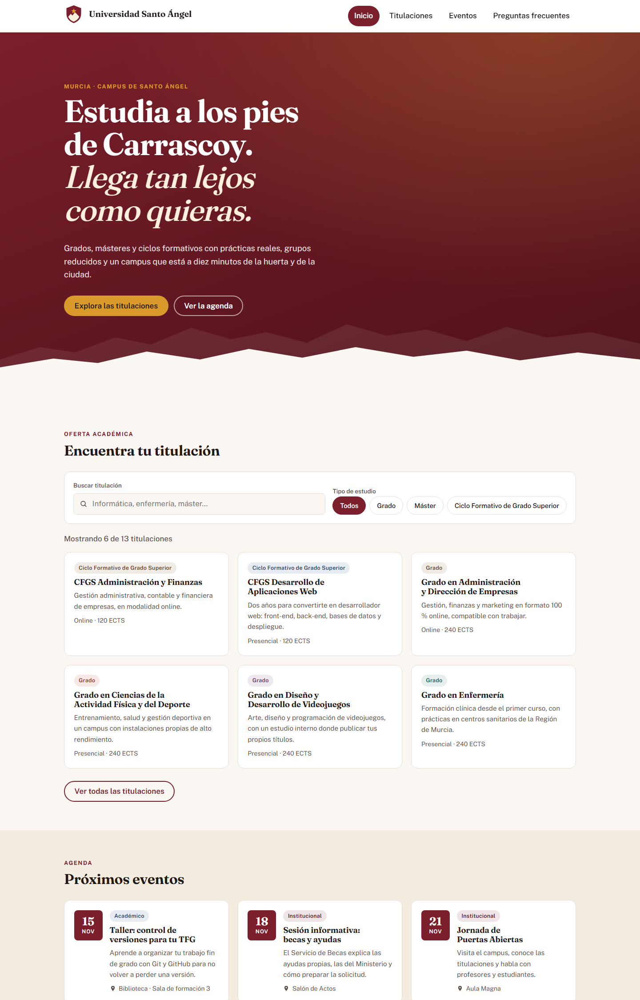
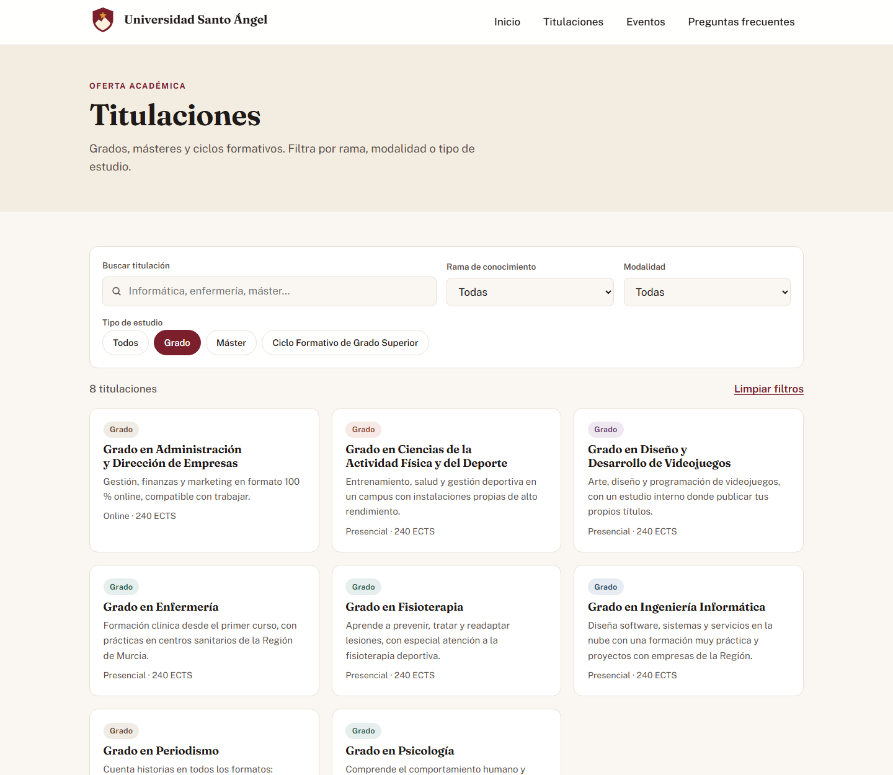
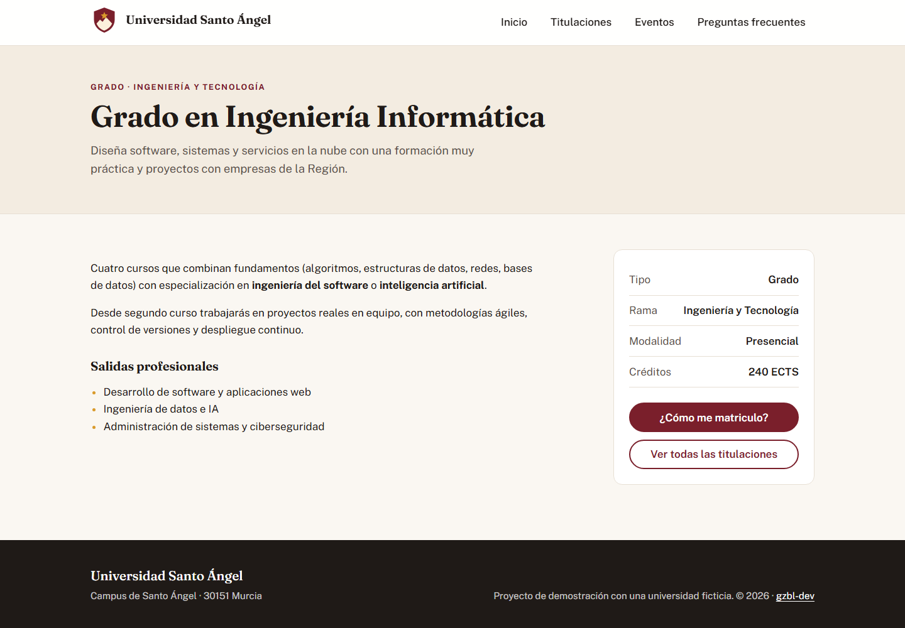
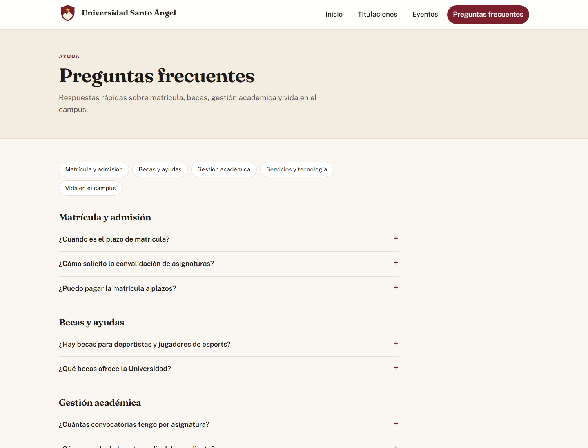
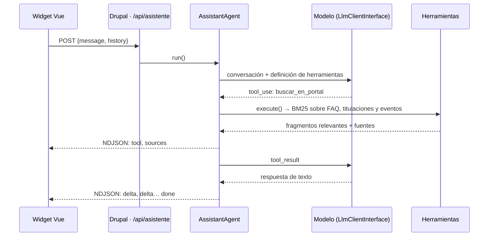
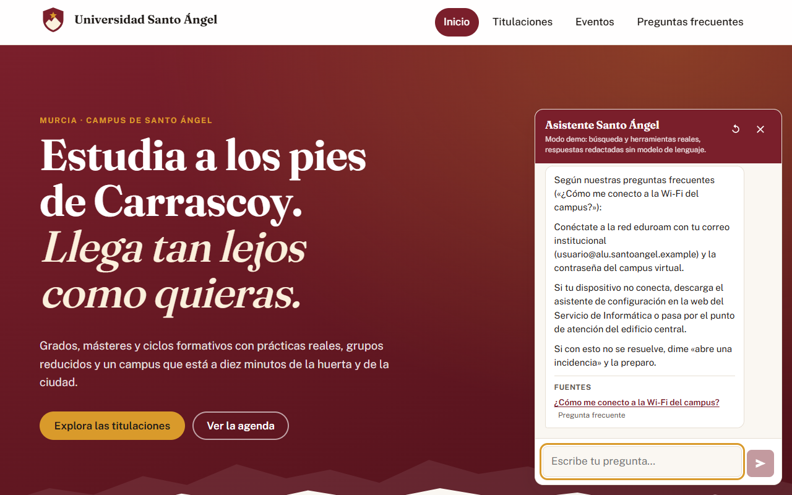
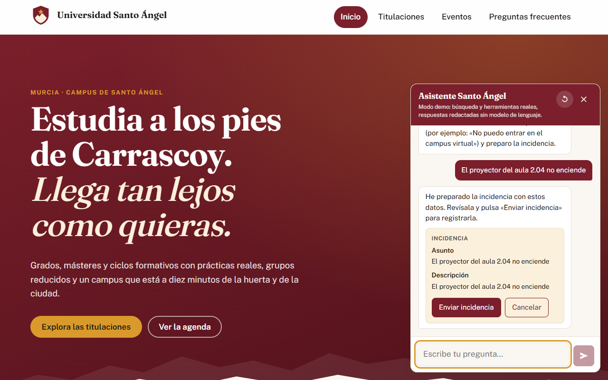

# Universidad Santo Ángel · Portal web + IA

Portal de una universidad **ficticia** (Santo Ángel es mi pueblo, en Murcia) construido sobre **Drupal 11**, con un tema a medida en **Twig + Sass**, widgets en **Vue 3 + TypeScript** que consumen la API **JSON:API** de Drupal, y todo el entorno en **Docker**.

El proyecto crece por fases. Ya están la **base del portal** (fase 1) y un **[asistente con RAG y tool use](#asistente-fase-2)** integrado en Drupal (fase 2). Después vendrán un **servidor MCP** que expone el contenido del portal a agentes y **automatizaciones** con n8n y Bash (ver [Hoja de ruta](#hoja-de-ruta)).


https://github.com/user-attachments/assets/df4bee5a-b186-4d0a-a73a-77ea7ec6eb7b


> **Demo en vídeo (1:35):** portada, buscador con filtros, fichas, agenda, preguntas frecuentes y el panel de Drupal creando una titulación que aparece al momento en el buscador.

## Qué incluye

| Área | Implementación |
|---|---|
| **Drupal 11** | Módulo propio `sa_core`: tipos de contenido (Titulación, Evento, FAQ) definidos como configuración YAML, rutas y controladores, servicios con inyección de dependencias, dos bloques configurables, metadatos de caché (tags y max-age) y un comando Drush propio (`drush sa:seed`). |
| **Theming** | Tema `santoangel` sin tema base: plantillas Twig (página, hero, tarjetas, fichas), preprocess en `santoangel.theme`, colocación de bloques por configuración, Sass modular con mapas, mixins, funciones y bucles `@each`. Los tokens de diseño se exponen como custom properties para que Vue use los mismos valores. |
| **Vue 3 + TS** | Buscador de titulaciones montado sobre un bloque de Drupal: filtros por texto, tipo, rama y modalidad traducidos a filtros JSON:API, *debounce*, cancelación de peticiones con `AbortController`, filtros sincronizados con la URL, y estados de carga, vacío y error. |
| **Accesibilidad** | Mejora progresiva (sin JS se ve la lista de titulaciones), `role="status"` con `aria-live` para el número de resultados, `<details>` nativos en las FAQ, foco visible, `prefers-reduced-motion` y navegación móvil con `aria-expanded` y cierre con Escape. |
| **Extras** | Descarga de eventos en formato iCalendar (`.ics`, RFC 5545) para añadirlos al calendario. |
| **Asistente** | Módulo `sa_assistant`: agente con *tool use*, RAG con BM25 sobre el contenido de Drupal, respuestas en streaming (NDJSON), confirmación humana antes de escribir datos y límite de peticiones por IP. Detalles en [Asistente](#asistente-fase-2). |
| **Calidad** | 25 tests con Vitest y Vue Test Utils, 27 tests de PHPUnit, `vue-tsc` en modo estricto, `phpcs` con los estándares Drupal y DrupalPractice, y un CI en GitHub Actions que instala el sitio completo y hace pruebas de humo por HTTP (también al asistente). |
| **DevOps** | Docker Compose (Drupal + MariaDB), `settings.php` sin secretos (todo por variables de entorno) y scripts Bash de instalación, copia de seguridad con rotación y despliegue (`drush deploy`). |

<table>
  <tr>
    <td colspan="2"></td>
  </tr>
  <tr>
    <td></td>
    <td></td>
  </tr>
  <tr>
    <td></td>
    <td></td>
  </tr>
</table>

## Asistente (fase 2)

Un chat en todas las páginas públicas que responde dudas sobre la universidad con el contenido del propio portal, cita de dónde sale cada dato y puede abrir incidencias.

> **Modo demo.** Para no depender de una clave de API, el «modelo» es un proveedor simulado (`SimulatedLlmClient`) que elige herramientas con reglas y redacta la respuesta a partir de lo que estas devuelven. **Todo lo demás es real**: el bucle del agente, las herramientas, la búsqueda, el streaming y la confirmación. El widget lo indica en su cabecera.



| Pieza | Cómo está hecha |
|---|---|
| **Agente** | `AssistantAgent` repite el ciclo modelo → herramientas → modelo hasta tener respuesta, con un máximo de 4 vueltas. Es un generador de PHP: cada evento se envía en cuanto ocurre. Los mensajes siguen el formato de la Messages API de Anthropic (`text`, `tool_use`, `tool_result`). |
| **Herramientas** | `buscar_en_portal` (RAG), `buscar_titulaciones`, `proximos_eventos` y `abrir_incidencia`. Cada una es un servicio con la etiqueta `sa_assistant.tool` y su JSON Schema; el registro las recoge con `!tagged_iterator`. Validan sus argumentos porque vienen del modelo. |
| **RAG** | Índice BM25 en PHP (IDF, saturación por frecuencia y normalización por longitud) sobre los nodos publicados. Se guarda en caché con las etiquetas `node_list:*`: cuando un editor cambia una FAQ, el índice se reconstruye solo. Descarta fragmentos con poca puntuación o que cubren menos de la mitad de la pregunta, para que el modelo no responda con una página que solo comparte una palabra. |
| **Confirmación humana** | La única herramienta que escribe datos (`abrir_incidencia`) no se ejecuta: el agente guarda la propuesta con un token de un solo uso (almacén clave-valor con caducidad) y el usuario la confirma o la cancela desde el widget. La incidencia se crea como nodo sin publicar. |
| **Streaming** | `StreamedResponse` con NDJSON (un evento JSON por línea). El widget lo lee con `fetch` + `ReadableStream`, uniendo las líneas que llegan partidas entre trozos de red. |
| **Seguridad** | Límite por IP con la Flood API de Drupal, rutas que solo aceptan `application/json` (cierra el CSRF clásico) más cabecera `X-CSRF-Token` para usuarios con sesión, historial saneado en el servidor y texto pintado sin `v-html`. |
| **Widget** | Vue 3 + TypeScript: estado de lo que está haciendo el agente, fuentes enlazadas, conversación guardada en `sessionStorage` (sobrevive al pulsar una fuente), anuncio de la respuesta completa a lectores de pantalla y diseño de hoja inferior en móvil. |
| **Administración** | Formulario en *Configuración → Servicios web → Asistente del portal* (bienvenida, sugerencias, límite), hooks como clase con atributos `#[Hook]` (Drupal 11.1+) y comandos `drush sa:index` y `drush sa:ask`. |

Conectar un modelo real es escribir otra implementación de `LlmClientInterface` y registrarla en `sa_assistant.services.yml`: el agente, las herramientas, el widget y los tests no cambian.

<table>
  <tr>
    <td></td>
    <td></td>
  </tr>
  <tr>
    <td colspan="2" align="center"></td>
  </tr>
</table>

```console
$ drush sa:ask "¿Qué másteres hay online?"
→ buscar_titulaciones
  fuentes: Máster en Inteligencia Artificial Aplicada

Tenemos 1 máster online:
- Máster en Inteligencia Artificial Aplicada · Online · 60 créditos
```

## Puesta en marcha

Requisitos: Docker Desktop y Node.js 20 o superior.

```bash
cp .env.example .env

# 1. Compilar el tema (Sass) y los widgets (Vue)
cd frontend && npm install && npm run build && cd ..

# 2. Levantar Drupal + MariaDB
docker compose up -d --build

# 3. Instalar el sitio: Drupal en español, módulo, tema y contenido de demostración
docker compose exec drupal bash scripts/install.sh
```

Abre <http://localhost:8080>. El panel de administración está en `/user/login` (admin / admin).

| Comando | Para qué |
|---|---|
| `docker compose exec drupal drush sa:seed --reset` | Regenera el contenido de demostración. Las fechas de los eventos se recalculan desde hoy. |
| `docker compose exec drupal drush sa:ask "¿Cuándo es la matrícula?"` | Pregunta al asistente desde la terminal y muestra cada herramienta que usa. |
| `docker compose exec drupal drush sa:index` | Reconstruye el índice del RAG y muestra cuántos documentos y términos tiene. |
| `docker compose exec drupal bash scripts/backup.sh` | Copia de la base de datos y los ficheros, conservando las 7 últimas. |
| `docker compose exec drupal bash scripts/deploy.sh` | Copia de seguridad, `composer install --no-dev` y `drush deploy`. |
| `cd frontend && npm run dev` | Entorno de desarrollo del widget con una API simulada (no necesita Drupal). |
| `cd frontend && npm test` | Tests de los widgets. |
| `cd drupal && composer test` | Tests de PHPUnit del asistente (BM25, agente, proveedor simulado). |
| `cd drupal && composer lint` | Estándares de código de Drupal. |

## Estructura

```
├── docker-compose.yml
├── drupal/                          Proyecto Composer (drupal/recommended-project)
│   ├── Dockerfile
│   ├── scripts/                     install.sh · backup.sh · deploy.sh
│   └── web/
│       ├── modules/custom/sa_core/
│       │   ├── config/install/      Tipos de contenido y campos (YAML)
│       │   ├── data/                Contenido de demostración (JSON)
│       │   ├── src/                 Controlador, servicios, bloques, comando Drush
│       │   └── templates/           Plantillas Twig del módulo
│       ├── modules/custom/sa_assistant/
│       │   ├── src/Agent/           Bucle del agente y acciones pendientes
│       │   ├── src/Llm/             Interfaz del modelo y proveedor simulado
│       │   ├── src/Search/          Tokenizador, índice BM25 e índice del portal
│       │   ├── src/Tool/            Herramientas (tool use)
│       │   └── tests/src/Unit/      PHPUnit
│       └── themes/custom/santoangel/
│           ├── scss/                abstracts · base · layout · components
│           └── templates/           page, hero, node, tarjetas, marca
├── frontend/                        Vue 3 + TypeScript + Vite + Vitest
│   ├── src/widgets/buscador/
│   ├── src/widgets/asistente/
│   ├── tests/
│   └── dev/                         API JSON:API simulada para desarrollo
└── .github/workflows/ci.yml
```

## Decisiones técnicas

- **Configuración como código.** Los tipos de contenido y los campos se definen en YAML dentro del módulo. Las pantallas de formulario y visualización se configuran en `hook_install()`, y la colocación de bloques viene en el tema. Una instalación limpia deja el sitio idéntico siempre.
- **JSON:API del core en vez de endpoints a medida.** El widget pide solo los campos que necesita (*sparse fieldsets*) y filtra en el servidor. El comportamiento se puede probar con `curl` sin tocar código PHP.
- **Vue como isla, no como SPA.** Drupal sigue sirviendo el HTML (SEO, caché de página, accesibilidad sin JS) y Vue se monta solo donde aporta interactividad. Así es como se suele integrar JavaScript moderno en portales grandes ya existentes.
- **Una sola fuente de datos de demostración.** Los JSON de `sa_core/data` alimentan `drush sa:seed` y la API simulada del entorno de desarrollo. El asistente no los lee: indexa los nodos de Drupal, así que responde con lo que haya publicado el equipo editorial.
- **BM25 antes que embeddings.** Con unas decenas de documentos, una búsqueda léxica bien ajustada acierta, no necesita otro servicio ni otra clave, y cada resultado se puede explicar término a término. La herramienta de búsqueda es la única pieza que cambiaría para pasar a embeddings.
- **El modelo, detrás de una interfaz.** El agente solo conoce `LlmClientInterface`. Eso permite la demo sin coste, tests del bucle con un modelo guionizado y cambiar de proveedor sin tocar nada más.

## Cómo he usado la IA en este proyecto

He desarrollado el proyecto con un asistente de programación con IA (Claude Code). Mi forma de trabajar es la misma que aplicaría en un equipo: la IA propone, y yo reviso, ejecuto y valido antes de dar algo por bueno. Algunos fallos que salieron al **probar de verdad** el código generado, y que no se veían leyéndolo:

- La inyección de dependencias por tipo (*autowiring*) fallaba con el servicio de transliteración, porque el core no registra un alias para su interfaz. Se resolvió enlazando el argumento de forma explícita en `sa_core.services.yml`.
- Drupal 11.4 arranca con `symfony/runtime`. Desactivar ese plugin de Composer rompía `index.php`, aunque Drush seguía funcionando.
- El instalador de Drupal añade credenciales fijas a `settings.php`. El script de instalación ahora lo protege y lo restaura.
- Sin tema base, el core no pone la clase `.menu` en los menús, así que el CSS previsto no se aplicaba. Lo detecté con capturas reales del navegador.
- En el asistente, los tests unitarios pasaban, pero al hacerle preguntas reales fallaba: «wifi» no encontraba «Wi-Fi», «aparcar» no encontraba «aparcamiento», y «¿cuánto cuesta un piso en Murcia?» se respondía con la FAQ de certificados solo porque contiene «cuesta». Lo arreglé con una raíz común para cada familia de palabras y con el umbral de cobertura.
- El asunto de una incidencia se cortaba en «aula 2» porque el punto de «2.04» se tomaba como final de frase.
- El corrector automático de estilo (`phpcbf`) confundió la palabra «Todos» de un comentario con un `TODO` y la convirtió en `@todo s`. Ninguna herramienta, con o sin IA, se acepta sin revisar.

Por eso el CI no solo pasa linters: **instala el sitio completo y comprueba por HTTP las páginas y el asistente**.

## Hoja de ruta

- [x] **Fase 1 · Portal.** Drupal 11, tema Twig + Sass, widget Vue con JSON:API, Docker, scripts Bash y CI.
- [x] **Fase 2 · Asistente IA.** Chat integrado en el portal que responde con RAG sobre las FAQ, las titulaciones y los eventos, citando la fuente, y usa herramientas (*tool use*) para buscar titulaciones, consultar la agenda o abrir una incidencia con confirmación. Funciona con un proveedor simulado; falta el adaptador para un modelo real.
- [ ] **Fase 3 · Agentes y automatización.** Servidor MCP que expone el contenido de Drupal a cualquier agente, flujo n8n que clasifica las consultas del formulario de contacto con un LLM y las envía al servicio que corresponde, y despliegue continuo.

---

Proyecto personal de [Gonzalo Bernal López](https://github.com/gzbl-dev). Universidad, datos, correos y personas son ficticios.
